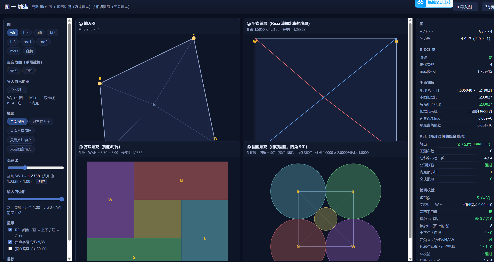

# 图 → 方块填充（矩形对偶）／圆盘填充（相切圆）

把一张平面三角剖分图变成**方块填充**：每个顶点一个方块，
图上相邻 ⟺ 方块**接触**（共享一段正长度的边），4 个角点被放到大长方形的四个角上。
外边界可以是 4 个点（8 个预设），也可以是 k > 4 个点（两个真实地图：美国各州、中国各省）；
**也可以是你自己的图** —— 按 `u` 或点「导入图…」，丢文件 / 拖进来 / 粘贴都行，
见下面「从文件导入平面图」。

用 **离散 Ricci（Yamabe）流**算度量，再等距铺展、解 **regular edge labeling (REL)**、
最后把 REL 翻译成矩形。前端是 React + Vite 的可视化，核心算法是零依赖的纯 ESM。

**第四幅图是圆盘填充**：同一张图、同一条流水线，只把度量族从「Ricci 流算出的平直度量」
换成**相切度量** `l_ij = r_i + r_j`，目标曲率**一个都不改**（4 个角点 π/2、其余 0）——
每个顶点一颗圆，图上相邻 ⟺ 两圆相切，四个角各 90°、墙点各 180°，外框是一个矩形。见下面「第四幅图」。

```
图（Tutte 嵌入：k 个边界点钉在凸四边形上 —— 4 个角点占 4 个角，其余沿边均匀铺开）
  →  Ricci 流：目标曲率 角点 π/2、其余 0  →  平直度量 g
  →  等距铺展（逐三角形摊平）→  长方形
  →  REL：每条内边蓝（下→上）/ 红（左→右）
  →  矩形对偶：并查集 + 最长路定层  →  方块填充

同一张图（同一份 Mesh）、同一套目标曲率，只换度量族：
  →  相切度量 l_ij = r_i + r_j（u_i = log r_i）→  阻尼 Newton（4–7 步）
  →  等距铺展（同一个 develop）→  圆心  →  相切圆盘填充（四角 90°）
```



*界面全貌（`W₅` 预设，`npm run dev` 的样子）：左栏选图 / 视图 / 长宽比 / 输入四边形 / 显示，
中间四幅图**同步高亮同一个顶点**，右栏把每一步的数字都摆出来。*

## 怎么跑

```bash
npm install
npm run dev      # http://localhost:5175
npm run check    # 无界面自检：601 项断言全带数字，见下方校验表
npm run build    # 产物在 dist/
```

核心算法在 `src/core/`，是**零依赖**的纯 ESM，`node` 里可以直接 `import`
（`npm run check` 就是这么跑的：不开浏览器、不碰 DOM）。

### 五分钟上手

1. 打开 `http://localhost:5175` —— 默认 `W₅`，四幅图同时出来；**鼠标放到任何一个顶点上，
   四幅图里同一个顶点一起亮**，这是看懂整套流程最快的办法。
2. 左栏「视图」可以只留一幅（或按 `v` 循环）；「显示」里的复选框管 REL 颜色 / 角点字母 / 顶点编号。
3. 拖**「输入四边形」**滑杆：从正方形（角点本来就是 `π/2`，Ricci 流没事干）滑到斜四边形，
   会看到 ② 的四角被流掰回直角、① 里的内点跟着动 —— 而 **④ 一动不动**（度量里没有坐标）。
4. 拖**「长宽比」**滑杆：只是把 ③ 在 x 方向整体拉伸，组合结构不变，④ 同样不受影响。
5. 按 `9` / `0` 看两张**真实地图**（美国本土 / 中国各省）：① 按经纬度画才认得出形状，
   灰色虚线块 = 人工块、橙色虚线 = 人工补的边，右栏有「地图数据（手写）」的逐条修补账。
6. 按 `u`（或点右上角「导入图…」）**导入自己的图**：选文件 / 拖到窗口任意处 / 粘贴文本，
   见下面「从文件导入平面图」。
7. 按 `?` 看全部快捷键。

## 界面

四幅图同步高亮同一个顶点 —— 这是理解整套流程的关键：

1. **① 输入图**：Tutte 嵌入（角点钉在输入四边形上），蓝/红显示 REL 的颜色与方向。
   地图预设改按**经纬度**画（才认得出地图形状），副标题里注明「仅用于显示」。
2. **② 平直铺展**：Ricci 流之后的实长度铺展，边界已经成直线、四角已经成直角。
3. **③ 方块填充**：矩形对偶铺满大长方形。地图上给每个方块标州名/省名。
4. **④ 圆盘填充**：同一张图上的相切圆盘（换度量族、目标曲率与③相同，与①②③并行算出来）。
   实线外框 = 4 条墙的圆心链（矩形，穿过圆心）。地图上给每颗圆标州名/省名，
   灰圆 = 人工块（水域 / 补块）。

键盘：`1..8` 换预设、`9 / 0` 美国 / 中国、`u` 导入自己的图、`←/→` 上一个/下一个、`r` 换随机图、
`[ ]` 加减点数、`v` 换视图（全部视图 / 单看某一幅）、`- =` 拉长宽比、`c` 归位、
`q Q` 换输入四边形（正方形 ↔ 本图自己的四边形）、`l` 顶点编号、`f` REL 颜色、`?` 说明。

| 侧栏项 | 作用 |
| --- | --- |
| 图 | 8 个预设（W₅、双锥 n=5..8、3 个随机 PTP）+「随机」按钮（8…240 点） |
| 导入自己的图 | 按 `u` 或点按钮：选文件 / 拖到窗口任意处 / 粘贴文本 —— 见下面「从文件导入平面图」 |
| 真实地图 | 美国（本土 46 块）/ 中国（26 块）—— 见下面「两个真实地图的例子」 |
| 视图 | 全部视图 / 只看输入图 / 只看铺展 / 只看方块填充 / 只看圆盘填充 |
| 长宽比 | 只把结果在 x 方向整体缩放（层间距自由），组合结构不变；**只影响③，不影响④** |
| 输入四边形 | 正方形（流没事干，长宽比 = 1）↔ 本图自己的四边形（老预设是那个斜四边形，地图是它的地理四边形）；**只影响①②③，不影响④** |

## 从文件导入平面图（按 `u`）

把所有其它来源都绕开的入口：丢进一张**自己的图**（一个平面三角剖分，或者一张声明了外圈的
一般平面图），它一样走 ①→②→③→④ 四幅图、右侧全部数字、长宽比滑杆，一个不少。
做法只有一句话：把文件变成和内建预设**同一个形状的 preset**（`{id, name, nv, faces,
corners?, quad?}` 再补上地图那套元数据），所以四个视图组件一行都不用改。

### 两种格式

**边表**（`.txt` / `.edges` / `.gr`；首字符不是 `{` 就按边表读）：

```
# 每行一条「u v」；# 开头的注释与空行都跳过
# corners: 0 3 7 4      ← 可选：外圈上逆时针的 4 个角点 S E N W
# boundary: 0 1 2 3     ← 可选：外圈（一般平面图必须给；三角剖分不用）
# pos: 0.1 0.2          ← 可选：顶点坐标（**只用来画 ①**）
# name: 我的图          ← 可选
8 13                     ← 可选表头 n m；m 不等于后面边表的行数就把首行当边读
0 1
1 2
```

**JSON**（首字符 `{`）：

```json
{ "name": "hex7", "nv": 7,
  "faces": [[0,1,6],[1,2,6],[2,3,6],[3,4,6],[4,5,6],[5,0,6]],
  "corners": {"S":4,"E":0,"N":2,"W":3},
  "pos": [[1,0],[0.5,0.866],[-0.5,0.866]],
  "names": ["东","东北","西北"] }
```

JSON 也可以用 `"edges": [[u,v],…]` 代替 `faces`（两个都给时 `edges` 优先）；
`faces` 只放**三角形内面**（外面不要放）；`corners` / `pos` / `names` 都可省。
朝向写乱没关系：先按「相邻面反着走公共边」把朝向传播一致再算（自检里拿反面朝向的 W₅
验过：传播后与原图同一张，长宽比一样）。**下标基**：0 基为默认；出现等于 nv 的下标
（或表头里的 n）就按 1 基读（PACE `.gr` 惯例），界面上会说明实际用了哪个基。

### 面和外圈从哪来（三条路，按优先级）

1. JSON 给了 `faces` → 直接用（统一朝向后校验：每个面 3 个点、每条边被 1 或 2 个面用到）。
2. 声明了 `# boundary:` → Tutte 嵌入 + 面游走 + 三角化（一般平面图走这条）。
3. 什么都不声明 → **3-团法**：`面 = 3-团`，`外圈 = 只属于一个 3-团的边`。
   自检里对 **10 张内建图**（8 预设 + 2 地图）逐张验过：这样恢复出来的外圈边集与
   `mesh.boundary` **逐条相等**。

### 不够格的地方：自动修补并逐条记账，或者明确拒绝

| 偏离 | 处理 | 记的账 |
| --- | --- | --- |
| 面是 ≥ 4 边形但顶点两两相邻（是个团） | 加一条对角线剖成三角形 | `diagonal` |
| 面是 ≥ 4 边形又不是团 | 插一个**人工点**星形剖开（界面上是灰块） | `steiner` |
| 内点度 < 4 / 外圈上多余的度 2 点 | **并入**一个邻居（不丢任何相邻） | `merge` |
| 分离三角形 | 翻掉它的一条边（**贴着外圈**的那种也认得出） | `flip` |
| 球面三角剖分（每边恰属 2 个三角形、χ = 2） | 沿一个度 4 的顶点**剪开**成盘 | `cut` |
| K₅ / K₃,₃ 这类非平面图、不连通的图、外圈只有 3 个点、闭合曲面但没有度 4 的顶点、自环、重复边 | **拒绝**，说清卡在哪一条 | 红色拒绝文案 |

自检 9.5 每个合成 fixture 走一条（修完必须照跑）：
`steiner` V 6→7（长宽比 `1.233827`）、`merge` V 10→9（`1.231735`）、
翻边 —— 干净的分离三角形 10/21/12（`1.274848`）、**贴着外圈**的那种 7/14/8（`1.233827`）、
剪开八面体 6/12/8 → 5/8/4（`1.233827`）。

### 4 个角点：声明了就用，没声明就自动选

自动规则两条：**外圈上度为 2 的点强制当角点**（PTP 要求非角点外圈点度 ≥ 3，而且度 2 的点
钉在四边形边上必然退化），剩下的名额按「最大化最小间隔」贪心补满。选完还要**干跑**一遍
（默认就是整条 `runPipeline`，`dryRun:false` 时只到 `buildInputMesh`），抛了就换下一组候选
（最多 6 组候选 × 正 / 反两个朝向，全挂了才拒绝，并把每一组挂在哪一条列出来）——
实测「角点选得不好」是真会抛（`mesh: next 指针成不了环`）。三角形的整体朝向是组合上
分不出来的一个 coin flip，也由这次干跑定下来。

自检 9.4：网格族 `1×1 … 8×8` 什么都不声明直接可用（0 条修补、度 2 的外圈点全部落在自动
角点里、REL ✓ 铺满 ✓ ④ 四角 90°），长宽比依次
`1.233827 / 1.234278 / 1.219743 / 1.218048 / 1.217674 / 1.217463`。

### 三条要留意的诚实限制

1. **一般平面图（不是三角剖分）必须声明外圈** —— 边表里没有「哪个面是外面」，这是信息的
   真空缺，猜不出来。不声明就直接拒绝，并提示改用 `# boundary:` 或 JSON 的 `faces`。
2. **非平面图修不掉**：K₅（每条边夹在 ≥ 3 个三角形之间，χ = 5）、K₃,₃（一个三角形都没有）
   都明确拒绝，不硬算。
3. **外圈点数 k > 4 时，长宽比取决于「哪 4 个点当角点」** —— 这是下面「事实 1」的**限定
   条件**：k = 4 时角点没得选，长宽比只由输入四边形决定；k > 4 时同一个输入四边形下换一组
   角点长宽比就变。两张地图上把「度 2 的外圈点必须当角点」这条约束下的**所有**可行角点组
   都枚举了一遍：

   | 图 | 可行角点组 | 长宽比范围 | 声明的那组 | 自动选的那组 |
   | --- | --- | --- | --- | --- |
   | 中国（k = 15） | 364 组（360 组跑通，4 组嵌入退化） | `0.681406` … `0.902062`（相差 32.4%） | `0.795097` | `0.778278` |
   | 美国（k = 31） | 28 组（28 组跑通） | `1.608835` … `1.750372`（相差 8.8%） | `1.677339` | `1.694159` |

   小图同理：同一张 2×4 网格声明 `[v0 v3 v7 v4]` 给 `1.228345`，什么都不声明（自动选
   `[v1 v5 v6 v2]`）给 `1.234278`。所以**自动选角不是「还原用户本意」，只是给一组能跑的、
   间隔尽量均匀的角点**；要控制长宽比就得自己声明 `# corners:` / `corners`。
   右侧面板会写清这一次实际用的是哪 4 个顶点。

### 文件里的坐标只用来画 ①

`# pos:` / JSON 的 `pos` 与地图预设的经纬度**地位完全相同**：只影响「① 输入图」怎么画，
②③④ 只由拓扑决定（Tutte 嵌入照旧算一遍用于内部）。没给坐标也照跑，① 就用 Tutte 嵌入的画法。

### 自检里的数字（第 9 节，163 项）

- **往返**（最强的一条）：10 张内建图 → 边表 → 导入 → **0 条修补**，V / E / F / χ / 外圈边集、
  流 ✓ / REL ✓ / 铺满 ✓ / ④ 四角 `Σ|Σθ−π/2| < 1e-12` 逐项与原图相等。外圈只有 4 个点的
  8 个预设连长宽比都相等（差 < 1e-9）；两张地图的角点是自动选的，长宽比按上面那条限制
  **不同**（自检把这个「不同」本身写成了断言，见 9.3）。
- **渲染契约**（9.9）：导入的 preset 必须把 `kind / names / report.counts / repairs /
  dummies / extra / merges / excluded / ids` 全部填成正确的类型 —— `Stats.jsx` 会**无保护地**
  遍历它们，缺一个界面就直接抛。
- **大图**：20×20 网格（V = 441 / E = 1240 / F = 800 / 外圈 80）0 条修补，
  解析 + 建图 155 ms、整条流水线 77 ms，长宽比 `1.217422`。
- **0 个内点也照算**：K₄（外圈 4-圈 + 一条对角线）V = 4 / E = 5 / F = 2，
  流 ✓ REL ✓ 铺满 ✓ ④ 四角 90°。

## 算法

输入是**一个平面三角剖分圆盘 + 指定的 4 个角点**，输出是「每个顶点一个矩形、相邻的正好贴边」
的铺满。中间五步，每步都能在右侧面板和 `npm run check` 里单独量到数字。全部代码在
`src/core/`，**零依赖**的纯 ESM。

**前提（`ptp.js`）**：每个内面都是三角形；外边界是简单圈、被 4 个角点分成 4 段非空链
（外圈只有 4 个点时就是「外边界是 4-圈」）；没有分离三角形；内点度 ≥ 4 —— 合称 PTP。
这是矩形对偶存在的**充要条件**（Kozminski–Kinnen），所以它同时是算法前提和输入校验。
实测 `W₅`：V=5 / F=4 / 边界 4 / 分离三角形 0 / 内点最小度 4 ✓，
欧拉示性数 V−E+F = 1 ✓，Gauss–Bonnet ΣK = 2π = 6.28318531 ✓。

### 1. 初始嵌入：Tutte + 均值坐标（`embed.js`）

外边界**钉在输入四边形上**（外圈点数 k > 4 时，4 个角点钉在四角、其余边界点沿四条边
均匀铺开），内部点解一次 Tutte 线性系统，再用**均值坐标（MVC）**细化 3 轮 ——
MVC 权重全正，所以 3-连通图的 Tutte 定理仍然保证**无翻转**。实测 `W₅` 最小面面积
`2.766e-1`，`checkEmbedding` ✓，外边界序 `[0, 2, 1, 4]`。

这一步产出的是 Ricci 流的**背景度量 l̄**（就是这套边长的账本）；① 画的坐标也来自它，
但地图的经纬度、导入图文件里的 `pos` 会**盖掉** ① 的显示（`GraphView.jsx:19`）——
②③④ 里的几何全部从 l̄ 重算，所以那些坐标一个数字都进不了算法。

### 2. 离散 Ricci 流：把度量共形变形到目标曲率（`ricci.js`）

```
度量族   l_ij = l̄_ij · e^((u_i + u_j) / 2)      （l̄ = 背景度量，u = 共形因子）
曲率     K_i  = 2π − Σθ（内点） / π − Σθ（边界点）
目标     K̄    = π/2（4 个角点）、0（其余点）
```

目标曲率能自洽是因为 Gauss–Bonnet 自动给 `ΣK = 2π = 4·(π/2)`。求解是带阻尼的 Newton：
对离散 Yamabe 能量求导给出 `dK = −½ L du`（`L` = 余切 Laplacian，半正定），
每步解 `L du = −2(K − K̄)`（钉住一个自由度定整体缩放），再回溯线搜索保证
`max|K − K̄|` 下降。实测 `W₅` **4 步**到 `1.776e-15`，四个角点累计角 `max|θ−π/2| = 1.110e-15`，
其余点 `max|K| = 1.776e-15`。

（流**不是**在所有剖分上都收敛 —— 这是数学障碍不是 bug，见「两个实测事实」的第 2 条；
真停住时用同四边形上的小图给一个参考长宽比兜底。）

### 3. 等距铺展：解码器（`unfold.js`）

从某个三角形出发，按流出来的边长把整张圆盘逐个铺到平面上（`placeThird`）。
流收敛后两件事同时成立：**角点**处累计角 = π/2 ⟹ 边界在角点拐直角；**墙点**（边界上
非角点）累计角 = π ⟹ 边界直线穿过。于是铺出来正好是一个**矩形**，这给出三条很强的
数值检验（`rectangleResiduals`）：

| 检验 | `W₅` 实测 |
| --- | --- |
| 4 条边成直线（垂距相对值 < 1e-9） | max 垂距 `0.000e+0` |
| 4 个角是直角 | `max|θ−π/2| = 4.441e-16` |
| 对边等长（矩形闭合） | 残差 `4.441e-16` |

**长宽比就是共形模**：`W₅` 铺出 `W = 1.505048`、`H = 1.219821`，`W/H = 1.233827475168`。
这个数是**离散共形模** —— 实测 8 个内建预设（内部结构完全不同）逐位相同，
连「只有 4 个顶点」的那个纯四边形 `grid1x1` 也是同一个数。它和**连续**共形模有
1.35% 的差，那纯粹是「外圈只取 4 个点」的离散化误差，把外圈加密就收敛过去
（`modulus.js` 是独立算的：把参数正方形细分成 N×N 网格铺到四边形上，解一次 Laplace
方程、取 Dirichlet 能量 `∫|∇u|²`，和 Ricci 流这条路完全不相干）：

| 外圈取多少个点 | 长宽比 | 与连续共形模的差 |
| --- | --- | --- |
| k = 4（8 个预设、`grid1x1`） | `1.23382748` | +1.35% |
| 4×4 网格（16 点） | `1.21767446` | +0.020% |
| 10×10 网格（40 点） | `1.21744549` | +0.0009% |
| 连续值（FEM N=40 / N=80 外推） | `1.21766374` / `1.21749212` → `≈1.217435` | — |

（「差」那一列是对着外推出来的 `≈1.217435` 算的；自检第 5c 节用的是能当场算出来的
FEM N=40，所以那里写的是 `1.327%`，容差 2% —— 两条路都不精确。）

### 4. REL：矩形对偶的组合骨架（`rel.js`）

给每条内边记上**颜色和方向**，含义是几何的：`blue (u,v)` = R(u) 正好在 R(v) **下面**（决定 y），
`red (u,v)` = R(u) 正好在 R(v) **左边**（决定 x）。约束是每个顶点处绕序的四块
（出蓝 OB → 出红 OR → 入蓝 IB → 入红 IR）**都非空**；边界点贴着哪面墙就缺哪一块；
外边本身的颜色/方向由几何定死。这是一个约束满足问题，实现成带重启的回溯搜索
（`maxBacktracks = 200000`）。实测：

| 预设 | 图案 | 回溯 | 与斜率标号一致 | 内点四块最小块 | 空块 |
| --- | --- | --- | --- | --- | --- |
| `W₅` | `OBIRIBOR` | 0 | 4/4 | 1 | 0 |
| `rnd1` | `OBIRIBOR` | 0 | 18/19 | 1 | 0 |
| `rnd3` | `OBIRIBOR` | 0 | 34/43 | 1 | 0 |

（「与斜率标号一致」是把 REL 和 `labelBySlope` 从铺展坐标里读出来的符号对照 ——
铺展图不嵌入时它会指错路，所以只当提示，不是判据。）

### 5. 矩形对偶 + 逐条校验（`rectdual.js` / `verify.js`）

把 REL 的相邻关系当成**等式**：`red (u,v): x2(u) = x1(v)`、`blue (u,v): y2(u) = y1(v)`，
四面墙分别是 `x1 = 0` / `x2 = W` / `y1 = 0` / `y2 = H`。用 union-find 把四组坐标合并成
若干个「层」，再给每个顶点加一条 `x1(v) → x2(v)`、`y1(v) → y2(v)` 的 DAG 边（权重 1，
表示至少一格宽），层坐标 = 从源点出发的**最长路** —— 取最小整数解（各段宽度本来是自由的，
可以用任意单调函数重新分配，组合结构不变）。最后按长宽比把 x 整体缩放（只动层间距）。
`verify.js` 不靠「看起来像」，逐条数：`W₅` 面积和相对误差 `0.00e+0`、接触对 8（= E）、
缺边 0 / 多边 0 / 十字点 0 / 自捏 0、四角正是 vS/vE/vN/vW。

### 第四幅图只换了一步

圆盘填充（`circlepack.js`）走**同一条流水线**，只把第 2 步的度量族换成相切度量
`l_ij = r_i + r_j`（`u_i = log r_i`），目标曲率一模一样（4 角 π/2、其余 0），
第 3 步的 `develop(mesh)` 原样就是解码器。详见下面「第四幅图：圆盘填充」。

## 为什么是「矩形」而不是「正方形」

一般图上**等大方块填充（squarified / square tiling）根本不存在**，能保证的只有矩形。
所以这里的语义是**矩形对偶**：矩形可以大小不等，允许 T 型接头（一个矩形的边被
另一个矩形的角分成两段）。存在性有定论（Kozminski–Kinnen）：外边界是 4-圈、
**无分离三角形**、内点度 ≥ 4（合称 PTP）⟺ 矩形对偶存在。输入非法时界面会直接报出来。

## 约定

- **角点**：铺展后按坐标认左下 `S`、右下 `E`、右上 `N`、左上 `W`（不是按输入编号）。
- **长宽比** `W/H`：`W` = S→E 方向的边长。正方形输入时为 1（自检里到 12 位）。
- **REL 颜色**：蓝 = 上下相邻（`u` 的下方是 `v`），红 = 左右相邻（`u` 在 `v` 左边）；
  箭头按 `from → to` 画，蓝从下往上、红从左往右。外边界钉死：SW/NE 蓝、SE/WN 红。
- **曲率**：`K_v = 2π − Σθ`（内点）/ `π − Σθ`（边界点）；目标 `K̄` 在 4 个角点是 `π/2`，
  其余点 0。Gauss–Bonnet 自动满足 `ΣK = 2π = 4·(π/2)`，所以目标是自洽的。

## 两个真实地图的例子（美国各州 / 中国各省）

侧栏「真实地图」里的两个 chip（键盘 `9` / `0`）：输入图是**真实的相邻关系图**
（美国本土各州 101 条相邻、中国各省 60 条相邻），输出是方块填充。
数据在 `src/core/maps/us.js` / `cn.js` 里**手写**（环境无网络，没有地理数据源），
所以每一条都被程序逐条核对，校验见自检第 7 节。

**这一步先把流水线推广了**：原来要求外边界恰好 4 个点，现在改成「k 个边界点 +
数据声明的 4 个角点」—— 4 个角点钉在输入四边形的 4 个角上（美国：加州 / 佛州 /
缅因 / 华盛顿州；中国：云南 / 广东 / 黑龙江 / 新疆），其余 k−4 个边界点沿四边形的边
均匀铺开（这样它们的初始曲率恰好是 0，Ricci 流只掰 4 个角）。`k = 4` 时行为和以前
完全一样，老预设的断言一条没松。

### 为什么真实相邻关系不可能全部原样保持

矩形对偶的存在性有定论（`PTP`：外边界 4-圈、无分离三角形、内点度 ≥ 4）。真实地图
天然违反其中几条，所以**必须**有偏离 —— 处理办法全部公开：

| 现象 | 美国 | 中国 | 后果与处理 |
| --- | --- | --- | --- |
| 叶子（只 1 个邻区） | 缅因只邻 NH，而它是 N 角点 | 北京排除后天津只邻河北 | 角点两条外边都要有真邻区 → 补 1 条人工边；非角点的叶子 → 并入邻区 |
| 被 3 个邻区围住（分离三角形） | — | 宁夏被 {内蒙古, 陕西, 甘肃} 围住 | 这时矩形对偶**不存在**，加人工边也救不回来 → 并入甘肃 |
| 空洞面（湖面）不是三角形 | 密歇根湖被 WI–IL–IN–MI 围成一个 4-圈 | — | 插真地理实体当**人工块**（这四州真在密歇根湖岸上，不是假边） |
| 墙上度 2 的点 | 罗得岛（只邻 MA、CT）、南卡（只邻 NC、GA） | 上海（只邻江苏、浙江） | 墙上的点要摆 3 个块 → 并入邻区（都不丢真实相邻） |
| 飞地 | DC 被马里兰包住 | 北京被河北整个包住 | 度 1，边界链上无处安放 → 排除 |
| 岛屿 | 阿拉斯加、夏威夷 | 台湾、海南、香港、澳门 | 与本土不连通，而这套框架是单连通盘 → 排除 |
| 一个区域贴外面两段 | 纽约（大西洋岸 + 安大略湖岸） | 河北（海岸被天津断开） | 边界圈会两次经过它，而一个矩形只能贴一次外框 → 插水域块把边界岔开（大西洋）；或并入使海岸连成一段（天津并入河北） |

**美国（48 州 → 46 块 + 2 个人工水块）**

| 偏离 | 内容 | 理由 |
| --- | --- | --- |
| 人工块 | 五大湖 ［water］← 威斯康星、伊利诺伊、印第安纳、密歇根 | 密歇根湖被这 4 州围成 4-圈，不是团、加不了对角线；这 4 州真的都在湖岸上 |
| 人工块 | 大西洋 ［water］← 纽约州、康涅狄格、新泽西 | 纽约既在大西洋岸又在安大略湖岸，去掉它新英格兰就断了；用真地理实体插在 NJ 与 CT 之间（纽约湾一带），边界就只经过纽约一次 |
| 人工边 | 缅因–马萨诸塞（橙色虚线） | 缅因只和 NH 接壤，而它是 N 角点；ME 与 MA 同在大西洋岸、中间只隔 NH |
| 点接触 | 亚利桑那–科罗拉多 | Four Corners：AZ/UT/CO/NM 只交于一点，补一条对角线才剖得开；两条对角线会相交，只能留一条 |
| 并入 | 罗得岛 → 马萨诸塞、南卡 → 佐治亚 | 都是墙上度 2 的点；合并**不丢任何真实相邻**（MA–CT、GA–NC 本来就是边） |
| 排除 | 阿拉斯加、夏威夷（不连通）、DC（被马里兰包住的飞地） | 单连通盘框架之外 |

**中国（34 个省级区域 → 26 块，没有人工块、没有人工边）**

| 偏离 | 内容 | 理由 |
| --- | --- | --- |
| 并入 | 宁夏 → 甘肃 | 分离三角形（见上表）；甘肃本来就与内蒙古、陕西相邻，不丢相邻 |
| 并入 | 天津 → 河北 | 北京排除后天津只剩河北一个邻区；并入后零损失，而且河北的海岸（沧州–天津–秦皇岛）连成一段，边界不再重复经过河北 —— 所以**不需要**「渤海」灰块（天津 1958–1967 年本来就是河北省会） |
| 并入 | 上海 → 江苏 | 墙上度 2；江苏本来就与浙江相邻，零损失 |
| 排除 | 台湾、海南、香港、澳门、北京 | 前四个与大陆不连通；北京是被河北整个包住的飞地 |

### 自检里的数字（`npm run check` 第 7 节，每张地图 21 项）

| 指标 | 美国 | 中国 |
| --- | --- | --- |
| 结构 V / E / F / χ | 48 / 110 / 63 / 1 | 26 / 60 / 35 / 1 |
| 外边界点数 k、内点最小度、墙点最小度 | 31、4、3 | 15、4、3 |
| 边：真实 / 人工块 / 人工边 / 点接触 | 101 / 7 / 1 / 1 | 60 / 0 / 0 / 0 |
| Ricci 流 | 收敛，4 步，`9.62e-13` | 收敛，5 步，`8.25e-13` |
| REL | 图案 `OBIRIBOR`，回溯 0，边界越界 0 | 同左 |
| 填充 `W × H`、长宽比 | `38.58 × 23.00`，`1.677339` | `10.34 × 13.00`，`0.795097` |
| **真实相邻 ⟺ 正长度接触**（缺 / 多） | 110 对接触，缺 0 / 多 0 | 60 对接触，缺 0 / 多 0 |
| 十字点 / 自捏 | 0 / 0 | 0 / 0 |
| 边界点贴框 / 内点贴框 | 31/31、0 | 15/15、0 |
| 面积相对误差 | `5.12e-16` | `2.12e-16` |
| 多出来的接触 = 声明的修补 | `110 − 101 = 9` = 7 + 1 + 1 ✓ | `60 − 60 = 0` ✓ |

三件事值得单独说：

1. **手写数据被逐条对账**：图上每条边都能在 `adj` / `dummies.neighbours` / `extra` 里
   找到出处（边数相等），反过来每条声明的相邻都真的在填充里贴了边（逐对查接触长度 > 0）。
2. **面列表要人工核对**（`node scripts/check.mjs --faces` 会把三角化前的面全打出来）：
   每个面都该是真实的多区交点 —— 美国有 `亚利桑那-科罗拉多-犹他`、`新泽西-大西洋-纽约州`、
   `密歇根-威斯康星-五大湖`，中国有 `内蒙古-辽宁-吉林`、`河北（含天津）-河南-山东`、
   `江苏（含上海）-安徽-浙江`。这是手写数据最关键的审查关卡。
3. **长宽比滑杆**：老预设是「正方形 ↔ 默认斜四边形」，地图是「正方形 ↔ 它自己的地理
   四边形」（4 个角点的经纬度归一化，见 `quadFromGeo`）。逐顶点凸组合出来的四边形仍然
   是凸的（自检把每一档都验了），所以 Tutte 嵌入不会因此翻面。

界面上怎么认：`①` 按经纬度画（灰色虚线 = 贴人工块的边，橙色虚线 = 人工边 / 点接触）；
`③` 里灰虚线块就是人工块，橙色虚线画在人工补出来的那条接触上；右侧数字面板有一块
「地图数据（手写）」账本，把每个偏离逐条连理由列出来。

## 第四幅图：圆盘填充（相切圆，四角 90°）

每个顶点一颗圆，**图上相邻 ⟺ 两颗圆正好相切**。目标曲率**和方块填充完全一样**
（4 个角点 `π/2`、其余顶点 0），于是解出来三条都能量：四个角各 **90°**、
墙点（边界上非角点）各 **180°**（边界圆心链在墙上走直线）、内点各 **360°** ——
4 条墙的圆心链因此围成一个**矩形**（外边界只有 4 个点时更是正方形）。

### 只换度量族

同一条流水线、同一个 `Mesh`，换的只是度量：

|  | ③ 方块填充 | ④ 圆盘填充 |
| --- | --- | --- |
| 度量族 `l_ij` | Ricci 流解出的**平直度量** | **相切度量** `l_ij = r_i + r_j`（`r_i = e^{u_i}`） |
| 目标曲率 `K̄` | 4 个角点 `π/2`，其余 0 | **同一套**：4 个角点 `π/2`，其余 0 |
| 解出来的量 | 边长 → 铺展成矩形 | 半径 → 铺展得圆心 |
| 解码器 | `develop` + REL + 矩形对偶 | **同一个 `develop`**，不需要 REL |
| 受滑杆影响 | 长宽比 = 输入四边形的共形模 | **完全不受影响**（度量里没有坐标） |

相切度量有个好处：半径恒正时 `r_i + r_j > |r_i − r_j|` **严格**成立，所以三角不等式
永远满足，不需要像平直度量那样在停住 / 翻边时打补丁。

### 一步 Newton，四条可量出来的结论（`src/core/circlepack.js`）

未知量 `u = log r`（`u → u + c` 不改任何三角形的内角，所以钉住 `corners[0]` 定整体缩放，
这也是唯一需要的规范自由度）。解 `K(u) = K̄`：数值差分 Jacobi 矩阵 + LU + 回溯线搜索，
从 `u ≡ 0` 出发。实测 **4–7 步到 `max|K̄−K| ≤ 8.9e-15`**，10 张图、以及 240 点的随机图都没失败过。

解出来逐条都能在铺展后的图上量（第 8 节每张图都测，下面是全部 10 张的极差）：

| 结论 | 判据 | 实测 |
| --- | --- | --- |
| 四个角各 90° | 角点 `Σθ = π/2` | 偏离 `4.3e-14`°…`5.1e-13`° |
| 墙是直的 | 墙点 `Σθ = π`，等价于「弦长 = 折线长 `Σ(r_i + r_{i+1})`」 | 弦/折线差 ≤ `8.9e-16` |
| 内部严丝合缝 | 内点 `Σθ = 2π` | `max|K| ≤ 5.3e-15` |
| 外框是矩形 | 对边相等、四角转弯 `90°` | 对边差 ≤ `3.7e-14`；转角偏离 ≤ `1.6e-10`° |
| `k = 4` 时是正方形 | 4 条边全相等 | 极差 ≤ `2.3e-14`（**每个** `k = 4` 的图都成立） |

最后一条值得单说，因为它是个小定理：**四角都是直角的四边形必是矩形**，而相切链给出
第 t 条边 `= r_t + r_{t+1}`，于是 `r_1 + r_2 = r_3 + r_4`、`r_2 + r_3 = r_4 + r_1`
⇒ `r_1 = r_3`、`r_2 = r_4` ⇒ 四条边全相等 —— 所以 **`k = 4` 时外框必是正方形，
跟内部结构无关**（8 个预设 + 240 点随机图都验过）。

### 另一种边界条件：极大填充（`mode:'maximal'`，不在界面上）

同一条流水线上还能换一个**不同的**边界条件：要求所有边界圆**同时内切于一个外圆**
（Koebe–Andreev–Thurston 的「极大」：没有哪颗圆还能再长大而不重叠）。代价是**角点角度不再受限**。

|  | ④ 界面里的（`mode:'angles'`） | 极大填充（`mode:'maximal'`） |
| --- | --- | --- |
| 边界条件 | 4 角各 `π/2`（与③同一套目标曲率） | 所有边界圆共一个外圆 |
| 算法 | 一步阻尼 Newton（`solveAngles`） | 球面流定初值 → 外圆打靶 → `Aut(D)` 规范固定 |
| 美国四角角度和 | **90° × 4** | 146.15° / 105.79° / 103.49° / 104.75° |
| 中国四角角度和 | **90° × 4** | 174.29° / 178.48° / 97.20° / 125.64° |
| 边界半径比（美国 / 中国 / `k=4`） | **1.24e4** / 30.5 / 1.0…1.9 | 754.3 / 7.5 / 1.0…1.4 |
| 耗时（美国 / 中国） | 4 ms / 1 ms | 204 ms / 33 ms |

**两者不是同一个填充，而且不能兼得**：`k = 4` 时四个角的条件里有 3 个独立，已经把解钉死
（只差一个整体缩放），再要求极大就多出 1 个条件 —— 一般不成立。第 8 节的 B 表逐张打印
极大填充的四角角度和，直接证明它不是 90°（唯一的例外是 `w5`：它本身就正方形对称）。
同一个现象也解释了半径比：**A 的比值比 B 更大**（美国 1.24e4 对 754），
这是两种边界条件各自的代价，不是实现问题（底下同一节讲机制）。

极大填充那三段算法的细节（球面流补 `∞`、只拟合圆心不拟合 `R` 的方差残差、以及
`imageCircle` 的「圆 → 圆」公式 `c′ = ( c̄a² − (1 + Δ)·a + c ) / A`、`ρ′ = ρ(1 − |a|²)/A`，
`A = |1 − āc|² − ρ²|a|²`、`Δ = |c|² − ρ²`）和两个踩过的坑都留在代码注释与第 8 节里：

- **拟圆不能热启动**（不然掉进另一个局部极小：美国残差停在 `1.69e-3`，`R` 从 1.327 变 1.257；
  每次从边界圆心重心出发 → `4.0e-15`）；
- **规范固定只能在收敛之后做**（外圆还只是最小二乘拟合时 `Aut(D)` 不是规范变换，
  早做会把收敛打散：美国残差炸到 `9.5e15`；代码里有 `max|e| ≤ 1e-9` 的闸）。
- 自检里拿**三点定圆的解析解**当基准，2 万次抽样独立核对「圆 → 圆」公式（圆心/半径
  最大误差 ≤ `1e-9`）。

### 自检里的数字（`npm run check` 第 8 节，每张图 A 组 11–12 项 + B 组 4 项）

A 组（界面里的那个）：

| 图 | V | k | 内点 | 角点偏离 90° | `K̄` 残差 | 相切误差 | 重叠/多余 | 外框 4 条边 | 直线/对边/转角偏差 | 边界半径比 | 耗时 |
| --- | --- | --- | --- | --- | --- | --- | --- | --- | --- | --- | --- |
| w5 | 5 | 4 | 1 | `4.3e-14`° | `6.7e-16` | `2.2e-16` | 0 / 0 | 2.0000 ×4 | `0.0e+0` / `1.6e-15` / `5.1e-14`° | 1.00 | 1 ms |
| bi5 | 6 | 4 | 2 | `9.9e-14`° | `1.8e-15` | `1.8e-15` | 0 / 0 | 2.3728 ×4 | `0.0e+0` / `3.6e-15` / `7.6e-14`° | 1.37 | 0 ms |
| bi6 | 7 | 4 | 3 | `5.7e-14`° | `1.8e-15` | `4.4e-16` | 0 / 0 | 2.6206 ×4 | `0.0e+0` / `1.8e-15` / `5.1e-14`° | 1.62 | 0 ms |
| bi7 | 8 | 4 | 4 | `9.9e-14`° | `1.8e-15` | `6.2e-15` | 0 / 0 | 2.7920 ×4 | `0.0e+0` / `8.4e-15` / `1.1e-13`° | 1.79 | 0 ms |
| bi8 | 9 | 4 | 5 | `2.4e-13`° | `5.3e-15` | `3.6e-15` | 0 / 0 | 2.9148 ×4 | `0.0e+0` / `9.3e-15` / `2.3e-13`° | 1.91 | 0 ms |
| rnd1 | 10 | 4 | 6 | `1.4e-14`° | `8.9e-16` | `2.2e-15` | 0 / 0 | 2.7361 ×4 | `0.0e+0` / `1.3e-15` / `5.1e-14`° | 1.74 | 1 ms |
| rnd2 | 14 | 4 | 10 | `1.3e-13`° | `2.2e-15` | `1.8e-15` | 0 / 0 | 2.6924 ×4 | `0.0e+0` / `4.0e-15` / `1.3e-13`° | 1.69 | 1 ms |
| rnd3 | 18 | 4 | 14 | `3.3e-13`° | `5.8e-15` | `1.4e-14` | 0 / 0 | 2.6544 ×4 | `0.0e+0` / `2.0e-14` / `4.7e-13`° | 1.65 | 0 ms |
| **us** | 48 | 31 | 17 | `5.1e-13`° | `8.9e-15` | `4.4e-15` | 0 / 0 | 2.6378 / 5.9800 ×2 | `8.9e-16` / `3.7e-14` / `1.6e-10`° | **1.24e4** | 4 ms |
| **cn** | 26 | 15 | 11 | `1.3e-13`° | `2.2e-15` | `2.4e-15` | 0 / 0 | 2.3382 / 2.1608 ×2 | `0.0e+0` / `4.9e-15` / `3.3e-13`° | **30.5** | 1 ms |

A 组每张图 11–12 项断言（都过）：四角 `π/2` / 墙点 `π` / 内点 `2π` / `K̄` 残差 → 0 /
对边相等 / 弦 = 折线 / 四角转弯 `90°` /（`k = 4` 时）4 边全等 / 相切对 = 边数
（最大误差 ≤ `4.4e-14`）/ 两两不重叠且无多余相切（最近的非边间隙 `2.1e-4`…`8.3e-1`，
美国 `2.1e-4`）/ 结束后 `mesh.len` 与返回半径自洽（重新 `develop` 圆心距最大差 `0.0e+0`…`1.5e-14`）/
与输入四边形无关（换正方形输入，半径最大相对差 `0.00e+0`）。B 组每张图 4 项：
球面流收敛 / 外圆残差 → 0 / 全在外圆内 / 相切且不重叠，另加两张地图各 1 项
「A 与 B 不是同一个填充」和（`k > 5` 时）零空间维数 = 2。

### 美国那幅图为什么长成这样（照实画 + 注明）

界面里美国的边界半径比是 **1.24e4**（最大 1.0、最小 `8.4e-5`）：边界圆里最小的是
缅因 `8.4e-5`（度 2）、新罕布什尔 `1.0e-4`、佛蒙特 `2.3e-4`、马萨诸塞+罗得岛 `7.9e-4`
（全在新英格兰那一角），最大的是爱达荷与加州 `1.0`、亚利桑那 `8.6e-1`、俄勒冈 `6.5e-1`。
这不是数值没收敛：**0 重叠、0 多余相切、110/110 条边相切误差 `4.4e-15`、
`K̄` 残差 `8.9e-15`、四角恰好 90°**，这个填充是精确解。原因是**固有的**：

- 外框是边界圆心的矩形，第 t 条边 `= Σ(r_i + r_{i+1})`，所以整圈周长被**内点的尺度**锁住。
  美国有 **31 个边界点**、只有 **17 个内点**，边界半径必然两极分化；`3F = 2E − b`
  对得上，网格本身完全健康（V=48 / E=110 / F=63 / χ=1，全是三角形）。
- 对照：中国 15 个边界点 → `30.5`；8 个 `k = 4` 的预设 → `1.0…1.9`（**哪怕内点到 14 个**）。
  比值跟着的是**边界点占比**，不是别的。
- 换一种边界条件（极大填充）也躲不掉：那个是 `754.3`，量级不同但同样是 `1e2`–`1e3` 级 ——
  「边界点多、内点少」这件事在两种条件下都逼出小圆，这是这张三角剖分的固有性质。

所以界面里那幅图我**照实画**（屏幕上半径小于 1.2 px 的圆就画成一个点，不放大、不隐藏），
并在④面板副标题和数字面板里都标「固有退化」+ 上面的数字。想看清小圆就把鼠标放上去
（高亮）或看数字面板里的半径。**故意不做**的事：不为了好看把小圆放大到看得见、
不给圆设一个最小尺寸 —— 那会让「图上相邻 ⟺ 相切」这条唯一硬指标失真。

### 与「两个真实地图」那节的关系（一句 KAT）

Koebe–Andreev–Thurston 说**任何**平面图都能实现为相切圆盘（每个平面图都是 coin graph），
「指定边界角度」这一版则来自 Andreev–Thurston / 离散单值化定理 —— 两者都只看组合结构，
所以圆盘填充的**存在性不需要任何修补**：不需要 PTP、不需要人工边、不需要水域补块。
但本实现走的是「流 + 三角剖分」这条路，**需要一张三角剖分**才能定义曲率和 `develop`，
所以第 2 步的地图构造（三角剖分、人工块、人工边）**照样要**：多出来的那些顶点和边
只是让剖分成形，到了④里也就多画几颗圆（灰圆 = 人工块）。

## 校验（`npm run check`：601 ✓ / 0 ✗）

每一行都给数字，出问题时能看出差多远。下面是主要几张表。
（第 1–6 节 = 233 项，第 7 节 = 两个真实地图 42 项，第 8 节 = 圆盘填充 163 项 ——
A 组（四角 90°，每张图 11–12 项）+ B 组（极大填充对照，每张图 4 项），
见上面「第四幅图」那一节；**第 9 节 = 用户图导入 163 项** ——
9.1 解析 25 + 9.2 3-团法 10 + 9.3 往返 61 + 9.4 自动选角 20 + 9.5 修补阶梯 18 +
9.6 拒绝路径 7 + 9.7 边界情形 5 + 9.8 三个示例 7 + 9.9 渲染契约 10，
见上面「从文件导入平面图」那一节。）

**① Ricci 流 + 铺展**（8 个预设，4…5 步收敛）：`max|K̄−K| ≤ 2.0e-14`、角点累计角
`|θ−π/2| ≤ 1.6e-14`、铺展后边界直线偏差 `0.000e+0`（相对值，8/8 精确为 0）、四角直角
偏差 `|θ−π/2| ≤ 1.4e-14`、矩形闭合残差 `≤ 2.1e-14`。

**② REL**：8/8 解出（图案全是 `OBIRIBOR`，回溯 0 次，0…5 ms），公理校验全通过，
内点四个块都非空（最小块 = 1），与斜率标号一致率 4/4 … 34/43（铺展图自交叠处
斜率提示会指错，只影响搜索顺序，不影响正确性）。

**③ 铺满校验**（`W·H` 用实际填充用的长宽比）：

| 图 | V | W × H | 面积相对误差 | 接触对 | 缺边 | 多边 | 十字/自捏 | 四角 | 结果 |
| --- | --- | --- | --- | --- | --- | --- | --- | --- | --- |
| w5 | 5 | 3.701482425505 × 3 | 0.00e+0 | 8 | 0 | 0 | 0 | ✓ | ✓ |
| bi5 | 6 | 3.701482425505 × 3 | 1.60e-16 | 11 | 0 | 0 | 0 | ✓ | ✓ |
| bi6 | 7 | 3.701482425505 × 3 | 0.00e+0 | 14 | 0 | 0 | 0 | ✓ | ✓ |
| bi7 | 8 | 3.701482425505 × 3 | 0.00e+0 | 17 | 0 | 0 | 0 | ✓ | ✓ |
| bi8 | 9 | 3.701482425505 × 3 | 0.00e+0 | 20 | 0 | 0 | 0 | ✓ | ✓ |
| rnd1 | 10 | 4.935309900673 × 4 | 1.80e-16 | 23 | 0 | 0 | 0 | ✓ | ✓ |
| rnd2 | 14 | 6.169137375842 × 5 | 1.15e-16 | 35 | 0 | 0 | 0 | ✓ | ✓ |
| rnd3 | 18 | 6.169137375842 × 5 | 2.30e-16 | 47 | 0 | 0 | 0 | ✓ | ✓ |

「缺边 / 多边」= 接触但不是图的边 / 是图的边但不接触，两项都必须为 0；
「十字点 / 自捏」= 四个矩形共点 / 两个矩形只在一点接触，也都必须为 0。

**④ 交叉验证**

| 检查 | 数字 |
| --- | --- |
| 随机 PTP 压力测试（nv = 20/60/120，共 12 张图） | 12/12（REL + 铺满） |
| 正方形输入 → 长宽比 | `1.000000000000`（两个预设） |
| 手动指定长宽比 1.5 | `W/H = 1.500000000`，铺满仍通过 |
| 铺展 `W/H` vs 独立 FEM 共形模（解 Laplace，N=40） | `1.23382748` vs `1.21766374`，差 **1.327%** |
| 15 张图（V = 5…120）的收敛长宽比互相之差 | `≤ 2.0e-13`，公共值 `1.233827475168` |

## 两个实测事实（重要，写在这里免得下次重新踩）

### 1. 长宽比只由**输入四边形**决定，与图的内部结构无关（**k = 4 时**）

自检第 6 节：8 个预设 + 12 张随机图，**只要流收敛**（15 张），铺展出来的 `W/H` 全都是
`1.233827475168…`（前 11 位相同，互相之差 ≤ `2.0e-13`）；而 V 从 5 到 120 差了几十倍。
换成正方形输入则一律是 `1.000000000000`。

**限定**：这条说的是「4 个角点已经定死」的情形（这 15 张图外圈都只有 4 个点，角点没得选）。
外圈点数 k > 4 时角点是可以换的，换一组长宽比就变 —— 中国地图上 364 组可行角点给
`0.681406` … `0.902062`（相差 32.4%），见上面「从文件导入平面图」里的表。

原因：对平面三角剖分的**任意**直线嵌入，内点恒有 `Σθ = 2π`（离散曲率 0），
流唯一要干的活是把 4 个角点的累计角掰到 `π/2`。而「4 个角点 + 各自的 π/2 锥角」
在离散共形类里定出的平直度量，其铺展长方形就是该四边形的共形模 —— 与内部
三角剖分无关。所以 `W/H` 是输入四边形（4 个点）的函数，FEM 解 Laplace 得到的
连续共形模与之差 1.327%，那是离散化的正常误差。

### 2. Ricci 流会在部分剖分上停住（是数学障碍，不是 bug）

`ricci.js` 用 Newton + 回溯线搜索，每步解 `L du = 2(K̄ − K)` 并要求 `max|K̄−K|` 下降。
实测：小图上 4…5 步就收敛到 `1e-14` 以下，但**大图上会卡住**，报「线搜索失败」，
`max|K̄−K|` 停在 `1.6e-2 … 4.8e-2`：

| 图规模 | 停住的比例（自检第 6 节的 12 张随机图） |
| --- | --- |
| nv = 20 / 60 | 0 / 6 |
| nv = 120 | 2 / 3 |
| nv = 200 | 3 / 3 |

诊断过程（都试过，结论一致）：换 2-范数线搜索、回溯里取最优 `t`、LM、一阶 Yamabe 流
全都同样停住 —— 所以不是实现或步长问题。真正原因是**离散共形类的平直度量可能落在
需要翻边的剖分上**（Delaunay 翻边之后立刻收敛，且翻边不改变共形类，长宽比还是
`1.233827`）。翻边会改掉图的边集，而输入图是用户给的，所以不能拿它当修法。

**兜底**：流停住时铺展出来的矩形长宽比不可信，但由事实 1，长宽比只取决于输入四边形 ——
于是改用「同一四边形在最小预设 W₅ 上收敛到的值」（`referenceAspect()`，按四边形缓存，
毫秒级）。`result.aspect = { used, source, flow }` 里 `source` 会标成 `reference`，
界面在侧栏和铺展面板上都会明确写出来，`flow.note` 说明停在第几步、误差多大。
REL 与铺满是纯组合的（用旋转序 + 层间距），所以停住的图**照样铺满通过**（自检第 6 节
逐张验证了这一点）。这里选择如实报告 + 明示兜底，而不是假装收敛。

## 文件结构

```
src/core/     纯 ESM，无 DOM 依赖，Node 里可直接跑
  ptp.js        PTP 校验（外边界 4-圈 / 无分离三角形 / 内点度 ≥ 4）、组合助手
  embed.js      Tutte / MVC 凸组合嵌入（角点钉在输入四边形上）+ 平面性检查
  mesh.js       半边邻接、角度/曲率、余切 Laplacian（FEM 刚度矩阵）
  ricci.js      离散 Ricci/Yamabe 流（Newton + 回溯线搜索，含 stalled/note）
  unfold.js     逐三角形等距铺展、角点排序、归一化框架、矩形残差
  rel.js        REL 的顶点图案对偶 CSP（AC + MRV DFS），公理校验、块统计
  rectdual.js   由 REL 造矩形（并查集 + 最长路定 x/y 层）
  verify.js     铺满校验：矩形数/面积/不重叠/接触⟺有边/十字/自捏/四角
  circlepack.js 圆盘填充：相切度量 + 目标曲率 Newton（默认，四角 90°）/ 极大填充三段
                （球面流 + 外圆打靶 + Möbius 规范固定）+ 外框与逐类角度校验
  modulus.js    独立的共形模参考（解 Laplace，交叉验证用）
  pipeline.js   串起全流程；buildInputMesh / runPipeline / referenceAspect / quadForPreset
  presets.js    8 个预设 + 随机 PTP 生成器（插点 + 洗牌）
  diskbuild.js  从 mapgraph.js 抽出的通用件：旋转序 / 面游走 / 边界嵌入 / 三角化 / 盘校验
  graphfile.js  导入策略：parseGraphFile（边表 / JSON）→ graphToPreset（3-团法 / 修补阶梯 /
                自动抢角 / 干跑回退）→ 一个和地图预设同形状的 preset
  examples.js   导入浮层里那三个内联示例（字符串，不落文件、不用 fetch）
  mapgraph.js   地图数据 → 平面三角剖分（调用 diskbuild.js，自己只管地图专有部分）
  maps/us.js    美国 48 州的手写数据：相邻、外边界、角点、人工块 / 人工边 / 合并 / 排除
  maps/cn.js    中国 34 个省级区域的手写数据（同上）
  maps/index.js 两个地图预设（buildMapGraph 的输出直接就是 pipeline 的 preset）+ 显示助手
src/components/ Panel / GraphView / FlatView / PackingView / CirclePackingView / Stats / Help
                / ImportPanel（导入浮层：文件 / 拖拽 / 粘贴 + 逐条修补账）
src/App.jsx     界面状态与四视图编排（两个填充各算一次，共用 buildInputMesh 的 Mesh）
scripts/check.mjs  无界面自检（601 项，每项都打数字；--faces 打印地图的面列表）
```

## 已知限制

- 输入必须是 **PTP**（外边界是简单圈 + 4 个角点把它切成 4 段非空链、无分离三角形、
  内点度 ≥ 4、墙点度 ≥ 3）；不满足时矩形对偶可能根本不存在，界面会报哪一条不满足。
  （从文件导入的图是例外：偏离这一条的地方会被**自动修补**并逐条列出理由，修不掉的
  明确拒绝 —— 见上面「从文件导入平面图」。）
- 边界顶点数 k > 4 时，k 个矩形都要贴外框、内点一个都不许贴 —— 自检里按 `k` 个
  逐个数（`boundaryOnFrame == k` 且 `interiorOnFrame == 0`）。
- **导入的一般平面图必须声明外圈**（`# boundary:` 或 JSON 的 `faces`）：边表里没有
  「哪个面是外面」这条信息，猜不出来，不声明就直接拒绝。三角剖分则什么都不用声明 ——
  面和 4 个角点都由 3-团法 + 自动抢角算出来。
- **导入的图外圈 k > 4 时，长宽比取决于「哪 4 个点当角点」**（中国 364 组可行角点给
  `0.681406` … `0.902062`，相差 32.4%；美国 28 组给 `1.608835` … `1.750372`）。自动选角
  只保证「能跑通 + 间隔尽量均匀」，**不保证和你想的那组一样**；要控制长宽比就自己声明
  `# corners:` / `corners`。k = 4 时角点没得选，才回到下面「事实 1」。
- **导入时修不掉的直接拒绝**，不做近似：非平面（K₅ / K₃,₃）、不连通的图、闭合曲面但没有
  度 4 的顶点可剪、外圈只有 3 个点、自环、重复边。修补只在**导入那一刻**做一次并逐条记账，
  之后拖长宽比 / 输入四边形滑杆都不会再改图的结构（只影响①②③的画法）。
- 两个地图的数据是**手写**的（环境无网络），真实相邻关系有 14 处（美国）/ 8 处（中国）
  公开偏离，见上面那张表；经纬度只用于显示，不过问结构。
- 铺展图可能是自交叠的 —— 那不影响组合信息（REL 只用旋转序和层间距），
  只影响「② 平直铺展」这画看起来乱不乱。
- 大图上的 Ricci 流可能停住（上面第 2 点），此时长宽比取参考值；度量本身不是平直的。
- **圆盘填充的边界圆可以小到亚像素**：这是「相切 + 边界点占多数」的固有后果，
  不是数值问题（美国边界半径比 1.24e4，见上面「第四幅图」）。界面照实画 + 标数字，
  不给小圆一个视觉上的放大或最小尺寸。
- 圆盘填充（`mode:'angles'`）里，**墙上度为 2 的顶点只能靠 `r → 0` 才「直」**
  （它只有一个三角形，要求 `Σθ = π`，取不到有限正值）。两个地图上这种顶点恰好都是角点
  而不是墙点（美国 `华盛顿州 / 缅因` 是角点），所以本仓库的图都没踩到；真踩到时
  Newton 会把半径推到极小、残差也许到不了 `1e-13`，这时返回值里的 `converged` / `note`
  会如实报出来，界面上的 `K̄` 残差那一行会变红。
- 极大填充（`mode:'maximal'`）**上限**受 `maxOuter = 60` 步打靶与 `tol = 1e-12` 约束；
  目前 8 个预设 + 2 个地图都在 8 步以内、残差 `≤ 1e-12` 收敛，更极端的图可能打满 60 步，
  这时返回 `obj` 与 `note` 会如实报出来，而不是假装收敛。
